# ModelOps — GPU LLM Inference on AWS EKS

ModelOps is a portfolio project that deploys **Qwen2.5-1.5B-Instruct** with **vLLM** on an **NVIDIA L4 GPU**, exposes a guarded public chat endpoint, and validates the setup with benchmark runs, API guardrail tests, and Prometheus-based GPU observability.

---

## 1) What this project demonstrates

- **GPU inference deployment** using **AWS EKS** on a **g6.xlarge / NVIDIA L4** node.
- **Public chat serving** through a simple UI and HTTPS path to a vLLM-backed model API.
- **API protection controls** for request body size, token limit, rate limit, and concurrent-request limit.
- **Observability** with **Prometheus**, **Grafana**, and **NVIDIA DCGM exporter**.
- **Benchmarking** of **EC2 vs EKS** inference behavior under controlled concurrency.

---

## 2) Simple architecture diagram

<p align="center">
  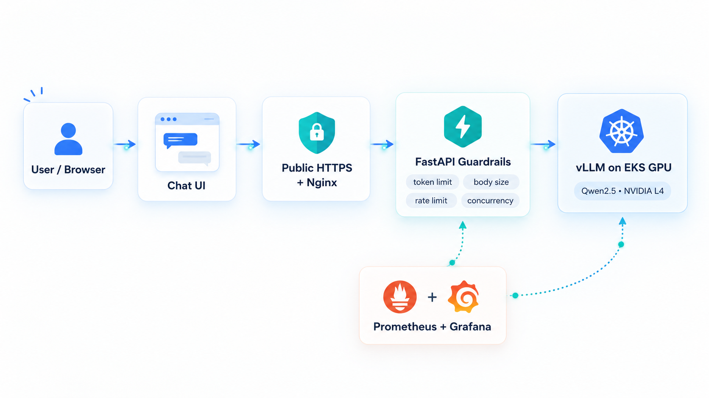
</p>

### Flow summary
1. **User / Browser** sends a prompt from the chat UI.  
2. Traffic enters through **public HTTPS + Nginx**.  
3. Requests pass through **FastAPI guardrails**.  
4. Valid requests reach **vLLM on EKS GPU** running **Qwen2.5** on an **NVIDIA L4**.  
5. **Prometheus + Grafana** monitor platform and GPU health.  

---

## 3) Core stack

- **AWS**: EC2, EKS, VPC, ALB/target groups, IAM
- **Container / orchestration**: Docker, Kubernetes, vLLM
- **Model**: Qwen2.5-1.5B-Instruct
- **GPU**: NVIDIA L4
- **Observability**: Prometheus, Grafana, NVIDIA DCGM exporter
- **Infra as code**: Terraform

---

## 4) Deployment evidence

### EKS cluster overview

<p align="center">
  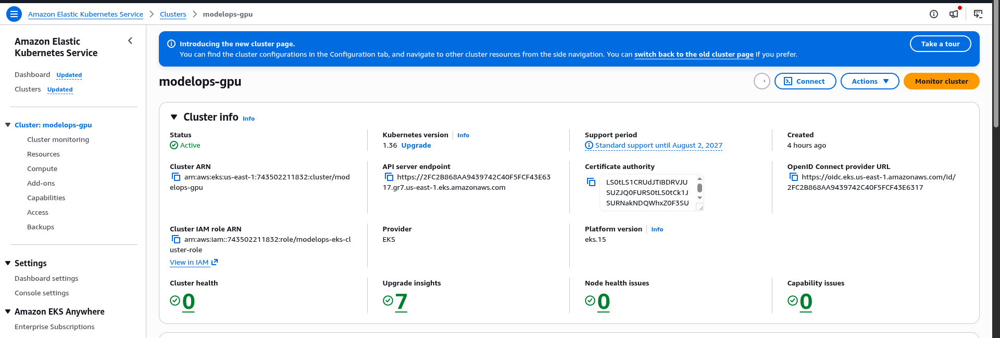
</p>

The EKS cluster `modelops-gpu` is shown as **Active** with Kubernetes **1.36**, healthy status, and no reported node-health or capability issues in the captured screen.

### GPU node group

<p align="center">
  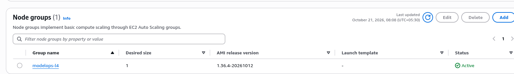
</p>

The GPU node group `modelops-l4` is shown as **Active** with desired size **1**.

### Target group health

<p align="center">
  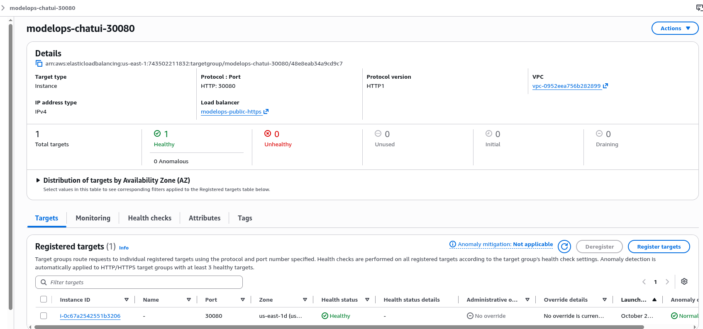
</p>

The ALB target group for the chat UI shows **1 healthy target**, confirming the traffic path from load balancer to application target.

### Working chat UI

<p align="center">
  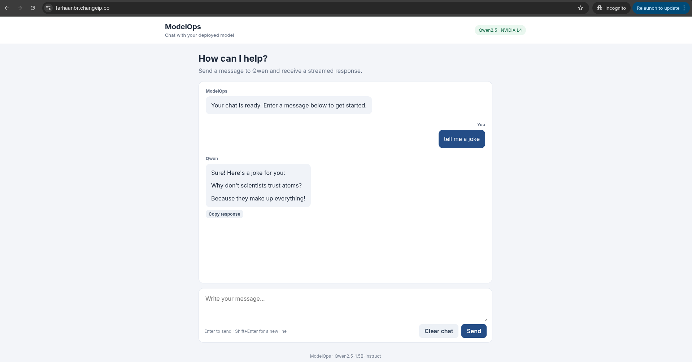
</p>

The public-facing chat UI successfully serves a prompt/response cycle (`tell me a joke`), showing an end-to-end working application path.

---

## 5) Benchmark highlights

### Paired EC2 vs EKS result used as the main comparison

| Concurrency | EC2 success | EKS success | EC2 tok/s | EKS tok/s | Difference | EC2 mean TTFT | EKS mean TTFT |
|------------:|------------:|------------:|----------:|----------:|-----------:|--------------:|--------------:|
| 1 | 24/24 | 24/24 | 75.599 | 75.362 | -0.31% | 0.021 s | 0.021 s |
| 4 | 24/24 | 24/24 | 292.628 | 292.488 | -0.05% | 0.036 s | 0.034 s |
| 8 | 24/24 | 24/24 | 292.890 | 292.700 | -0.06% | 1.124 s | 1.123 s |
| 16 | 24/24 | 24/24 | 292.421 | 292.184 | -0.08% | 2.660 s | 2.660 s |

<p align="center">
  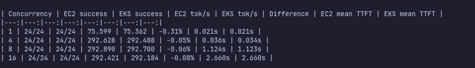
</p>

This run shows a **near-match between EC2 and EKS** when the test conditions were aligned.

### Exploratory comparison from a different run

<p align="center">
  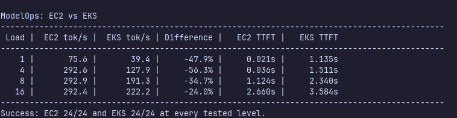
</p>

A separate exploratory run showed a larger EC2/EKS gap, which is useful evidence that benchmark conditions matter and should be documented carefully.

### EC2 first-inference baseline

<p align="center">
  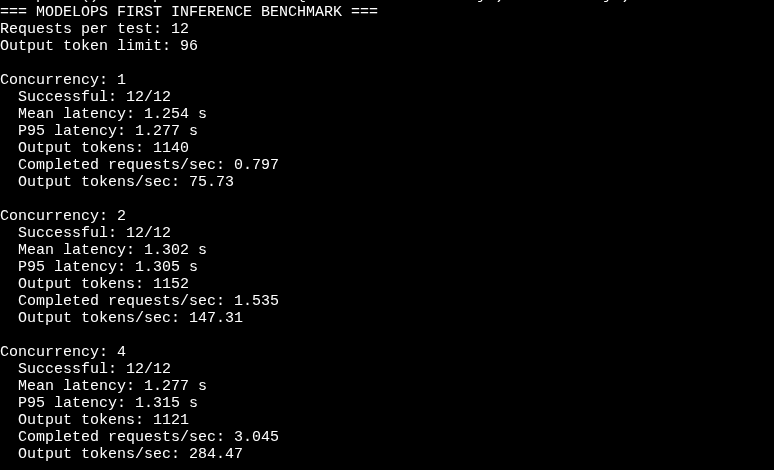
</p>

The first-inference baseline shows EC2 behavior across low concurrency levels, including output tokens/sec and latency.

---

## 6) API guardrail tests

The public chat API was tested for four important controls:

| Control | Observed behavior |
|---|---|
| **Concurrent-request limit** | 5 simultaneous requests against a limit of 2 → accepted/rejected mix with HTTP **429** |
| **Per-IP rate limit** | 13 requests against a limit of 12/minute → excess request returned HTTP **429** |
| **Request-body size limit** | Oversized request body → HTTP **413 Content Too Large** |
| **Token limit** | `max_tokens=513` against a server limit of 512 → HTTP **400 Bad Request** |

### Concurrent-request limit

<p align="center">
  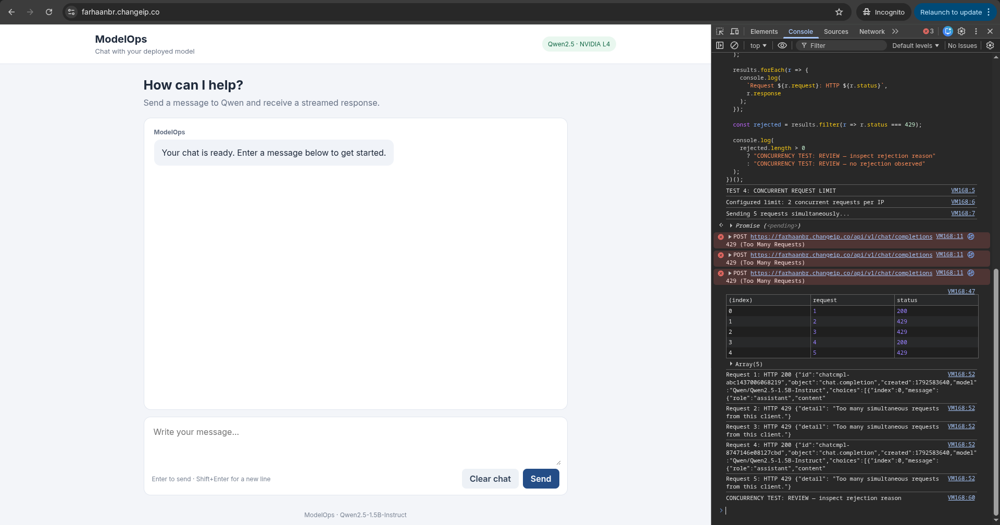
</p>

### Rate limit

<p align="center">
  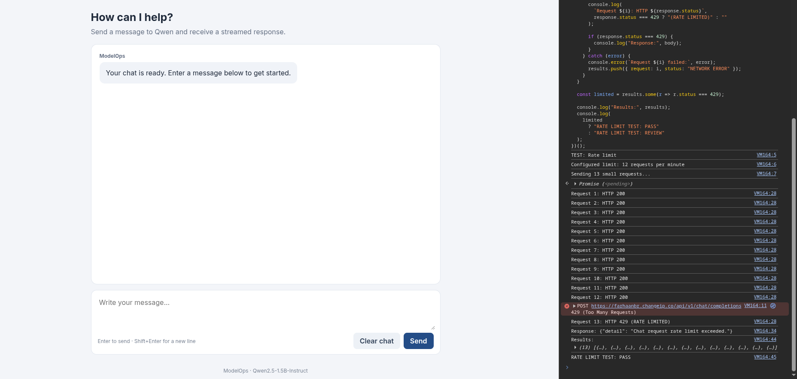
</p>

### Request-body size limit

<p align="center">
  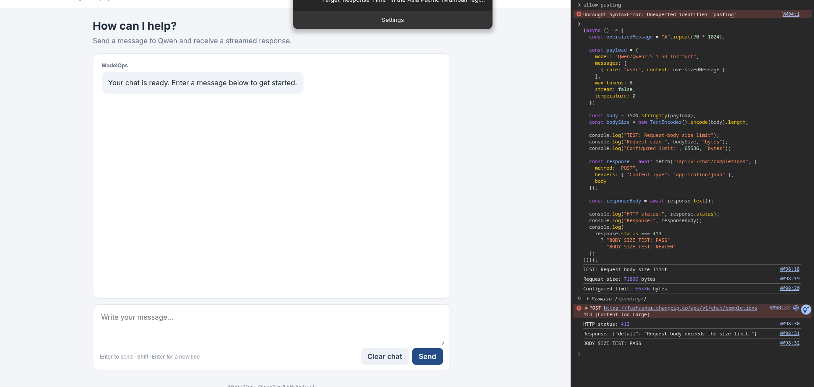
</p>

### Token limit

<p align="center">
  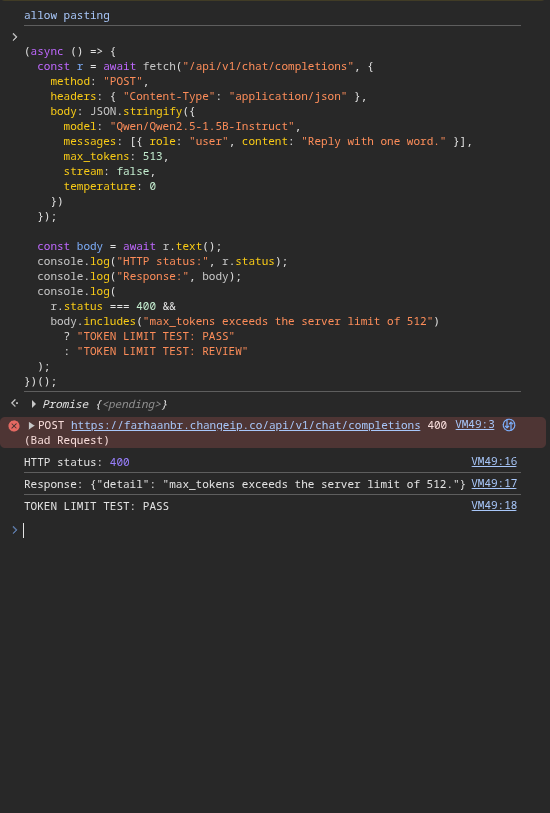
</p>

These tests show that the deployment is not only functional, but also **protected against oversized or abusive traffic patterns**.

---

## 7) Observability and GPU monitoring

### Prometheus target health

<p align="center">
  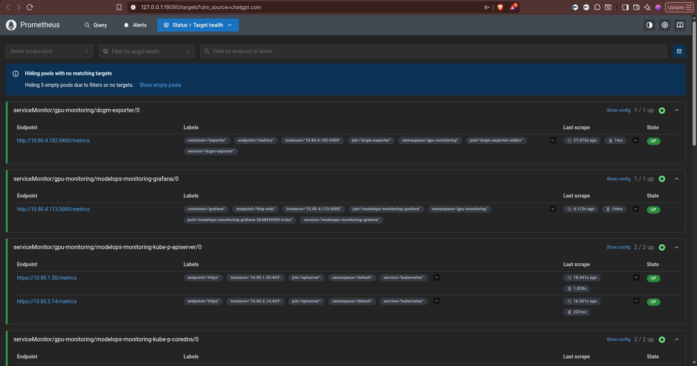
</p>

Prometheus successfully scraped targets including the **DCGM exporter**, **Grafana**, and Kubernetes control-plane endpoints shown as **UP** in the capture.

### Prometheus alerts view

<p align="center">
  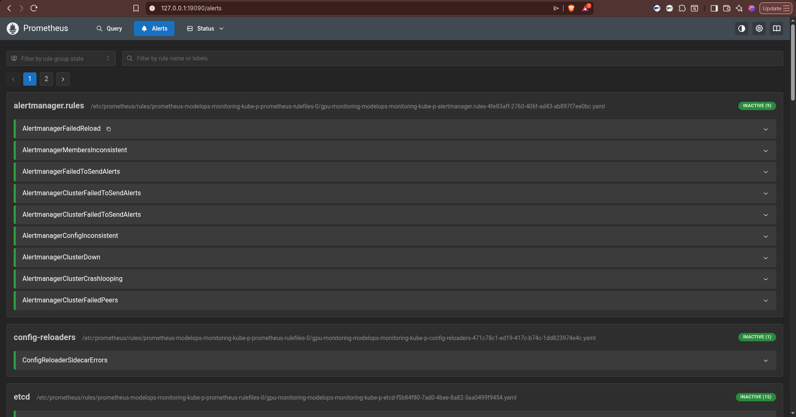
</p>

The alerts screen shows alert groups loaded and currently **inactive** at capture time.

### GPU telemetry queries

<p align="center">
  
</p>

<p align="center">
  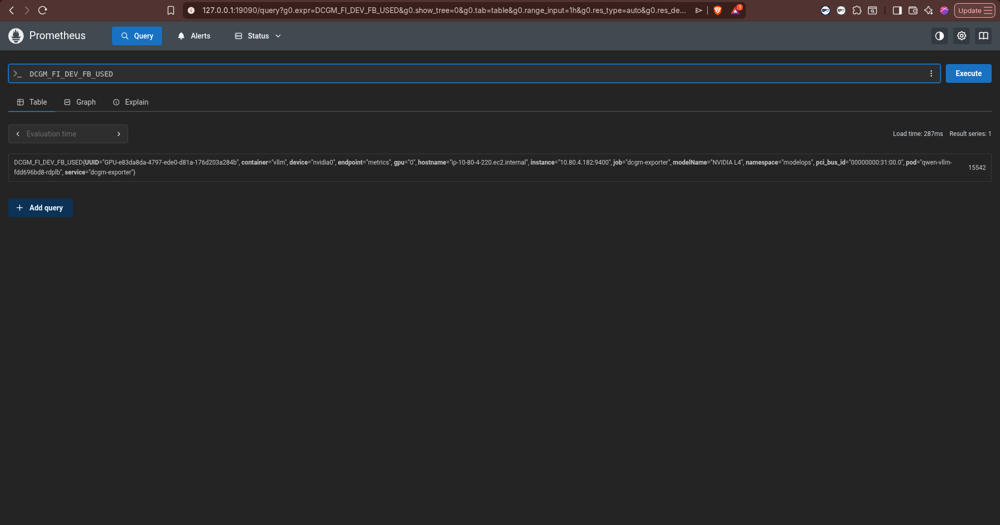
</p>

<p align="center">
  
</p>

The captured point-in-time Prometheus queries show:

- **GPU temperature**: `DCGM_FI_DEV_GPU_TEMP = 51`
- **Framebuffer memory used**: `DCGM_FI_DEV_FB_USED = 15542`
- **GPU utilization**: `DCGM_FI_DEV_GPU_UTIL = 0`

This confirms that **GPU metrics were being collected and queried successfully**.

---

## 8) EC2 baseline evidence

Before / alongside the EKS work, the project also validated a direct EC2 GPU baseline.

### EC2 baseline summary

<p align="center">
  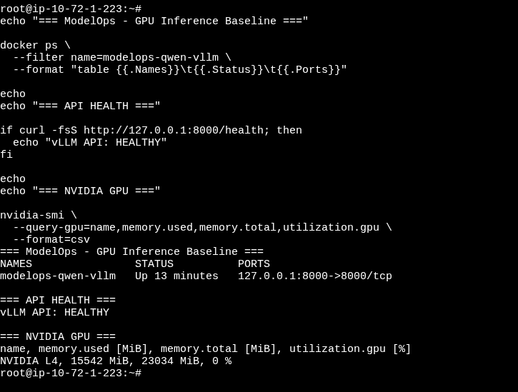
</p>

This capture shows:
- running container name: `modelops-qwen-vllm`
- API health check: **HEALTHY**
- GPU: **NVIDIA L4**, with memory-use snapshot shown in the terminal output

### Chat-completion smoke test on EC2

<p align="center">
  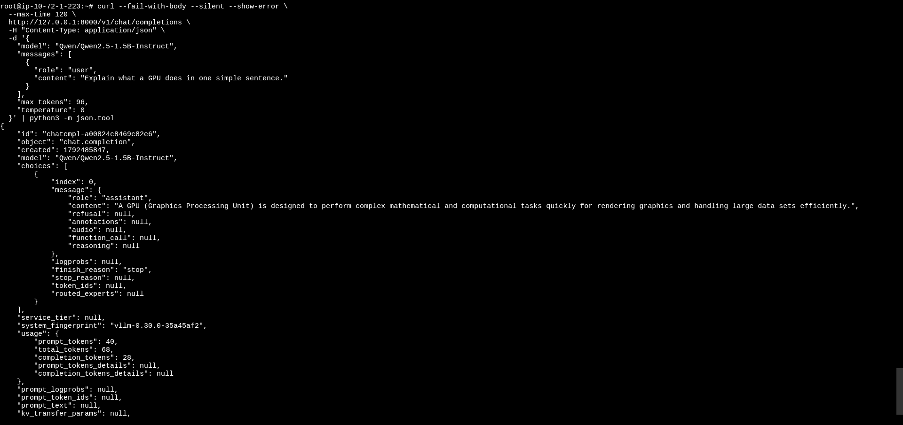
</p>

A successful `/v1/chat/completions` request returned a valid response from **Qwen/Qwen2.5-1.5B-Instruct**.

### Docker container status

<p align="center">
  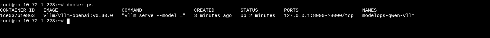
</p>

### NVIDIA SMI snapshot

<p align="center">
  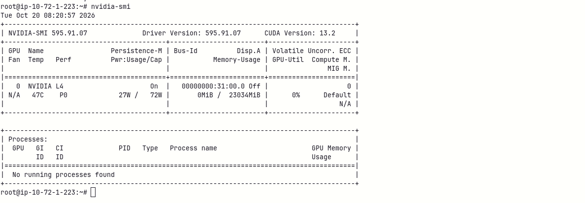
</p>

### EC2 instance console snapshot

<p align="center">
  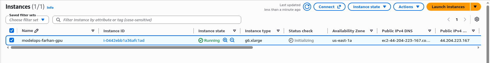
</p>

---

## 9) Key takeaways

- The project demonstrates a **working GPU inference system on AWS EKS**.
- The deployment includes **functional API protections** rather than exposing an unguarded model endpoint.
- **Prometheus/Grafana/DCGM observability** was wired in and verified with actual GPU metrics.
- Controlled benchmark runs show that **EKS can closely match EC2** in a paired setup, while separate exploratory runs show how easily benchmarking can diverge when conditions differ.
- The project includes both **infrastructure evidence** and **application-level proof** of success.

---

## 10) Cost-per-token note

**Cost per token is not finalized in this README** because the screenshots currently available do not provide a clean pairing of attributed AWS cost with the exact benchmark token totals.

When you add billing figures later, use:

```text
cost per 1,000 output tokens = attributable AWS cost / total output tokens × 1,000
```

Recommended cost components:
- GPU instance cost
- EKS control plane cost
- Load balancer cost
- storage / EBS
- data transfer
- monitoring overhead, if you want full system cost attribution

---

## 11) Files included in this package

```text
modelops-readme-package/
├── README.md
└── assets/
    ├── architecture-simple.png
    ├── eks-cluster-overview.png
    ├── eks-node-group.png
    ├── alb-target-group-healthy.png
    ├── chat-ui-success.png
    ├── guardrail-concurrency-limit.png
    ├── guardrail-rate-limit.png
    ├── guardrail-body-size-limit.png
    ├── guardrail-token-limit.png
    ├── prometheus-target-health.png
    ├── prometheus-alerts.png
    ├── gpu-metric-temperature.png
    ├── gpu-metric-memory-used.png
    ├── gpu-metric-utilization.png
    ├── benchmark-ec2-vs-eks-near-match.png
    ├── benchmark-ec2-vs-eks-exploratory-gap.png
    ├── benchmark-first-inference-ec2.png
    ├── ec2-baseline-summary.png
    ├── ec2-chat-completion-smoke-test.png
    ├── ec2-docker-container.png
    ├── ec2-nvidia-smi.png
    └── ec2-instance-console.png
```

